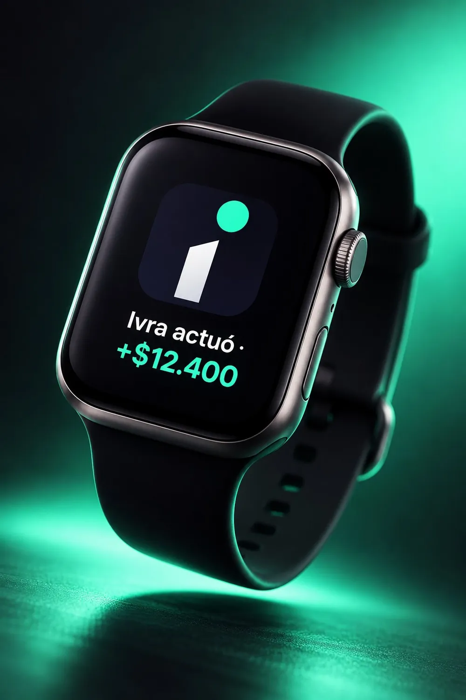
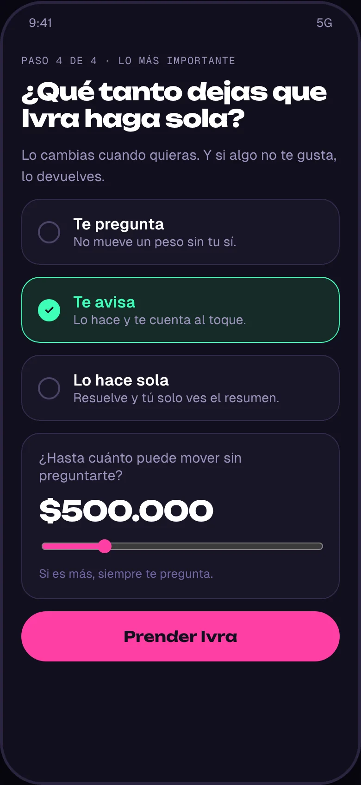
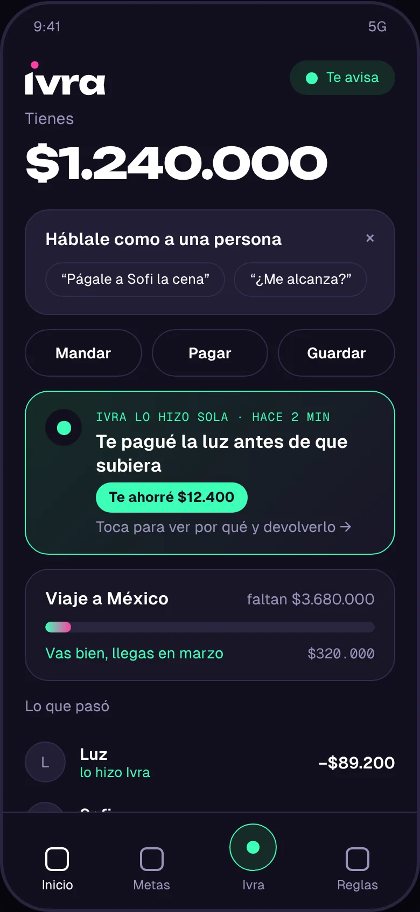
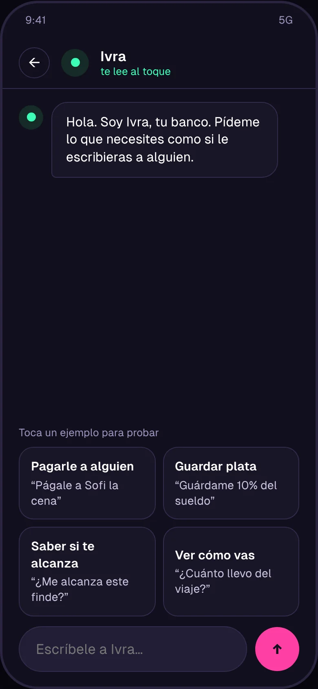
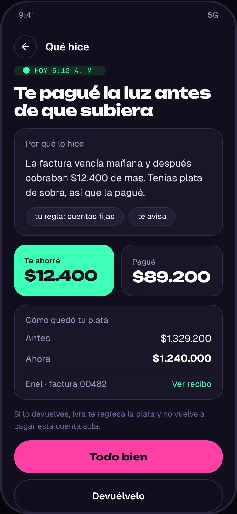
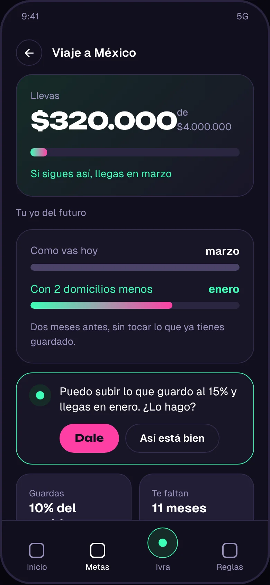

# Ivra · Tu dinero va un paso adelante.

Identidad de marca, campaña y app de un banco digital cuya IA no sugiere: decide y actúa.
**Proyecto conceptual · Fintech** · Caso de estudio de Aleja Moreno, diseñadora UI/UX y de marca (Bogotá).

**[Ver el caso completo](https://claude.ai/artifact/FjNjRFv1uiDRrFF2ENNtVZ)** · **[Probar el prototipo](prototipo/index.html)** · **[Portafolio](https://claude.ai/artifact/YJTEaRSG1YnHR7VLffyKBC)**


| Rol | Año | Tipo | Entregables |
|---|---|---|---|
| Estrategia de marca, UX y UI | [AÑO] | Proyecto conceptual | Marca, campaña, app y prototipo |

---

## El reto

**Diseñar confianza en un banco que actúa solo.**

Ivra es un banco digital cuya IA no sugiere: decide y actúa. Eso rompe el supuesto de toda app bancaria, donde cada movimiento lo inicia el usuario. El reto fue diseñar una experiencia en la que delegar tu dinero se sienta seguro.

> **La tensión:** cuanto más hace la IA, menos control siente la persona. Todo el UX resuelve eso.

## La marca

El punto de la "i" está lanzado hacia adelante, siguiendo la diagonal del palito: es la IA anticipándose a lo que viene, y es el ícono de la app. Ese ángulo de 24,7° se volvió el gesto de toda la marca.

**Regla de color:** rosa `#FF3FA4` es lo que haces tú. Menta `#3DFFB6` es lo que hizo Ivra. Nunca se mezclan en un mismo elemento.

<p>
  
  
  
</p>

## La app

**Nadie le entrega su plata a algo que actúa solo.** La pregunta de diseño dejó de ser cómo navegar y pasó a ser cómo confiar. Tres principios:

1. **Control:** todo lo que hace la IA se puede deshacer en un toque.
2. **Transparencia:** cada acción explica por qué se hizo, antes de decir cuánto costó.
3. **Autonomía graduable:** cada persona decide cuánto puede hacer la IA, desde el primer minuto.

<p>
  
  
  
  
  
</p>

### Cuatro decisiones de UX

1. **El nivel de autonomía va en el onboarding, no en ajustes.**
2. **Cada acción muestra su porqué antes que su monto.**
3. **Deshacer vive junto a la acción, no en el historial.**
4. **Hablar reemplaza al formulario, pero deja rastro visible.**

**Qué probaría con usuarios:** si al ver "Ivra actuó" la primera reacción es tranquilidad o alarma; qué nivel elige la gente y si lo sube con el tiempo; cuántos usan deshacer y por qué.

**Lo que me llevo:** Cuando un producto decide por alguien, el diseño deja de ser navegación y pasa a ser confianza: explicar, acotar y dejar salida.

---

## In English

Brand identity, campaign and app for a digital bank whose AI doesn't suggest: it decides and acts. A conceptual fintech project. The core UX challenge is trust: the more the AI does, the less control people feel. The app answers with three principles: everything the AI does can be undone in one tap, every action explains *why* before *how much*, and each person chooses the AI's level of autonomy from the first minute. The case is written in Spanish.

---

## Qué hay en este repositorio

```
index.html          Página del caso (HTML, CSS y JS sin build)
css/ivra.css        Tokens de la marca en :root
js/ivra.js          Recorrido del punto y transición marca → app (GSAP + ScrollTrigger + Lenis)
js/nav.js           Menú del caso en celular
img/ · pantallas/   Imágenes en WebP optimizado
prototipo/          Prototipo navegable de la app (HTML autocontenido)
fuente/             Material original: brief, textos aprobados, logos, mockups, campaña y manual
```

**Verlo en local:** `python3 -m http.server` en la raíz y abre `http://localhost:8000`. Abrir el archivo directo con doble clic también funciona.

**Publicarlo con GitHub Pages:** Settings → Pages → *Deploy from a branch* → `main` / `(root)`.

Tipografías: Unbounded, Geist y Geist Mono (Google Fonts). Animación: GSAP 3.12.5 y Lenis 1.1.13 por CDN.

---

Ivra es un proyecto conceptual: no es un banco real y el caso no incluye métricas de resultado ni investigación con usuarios.
